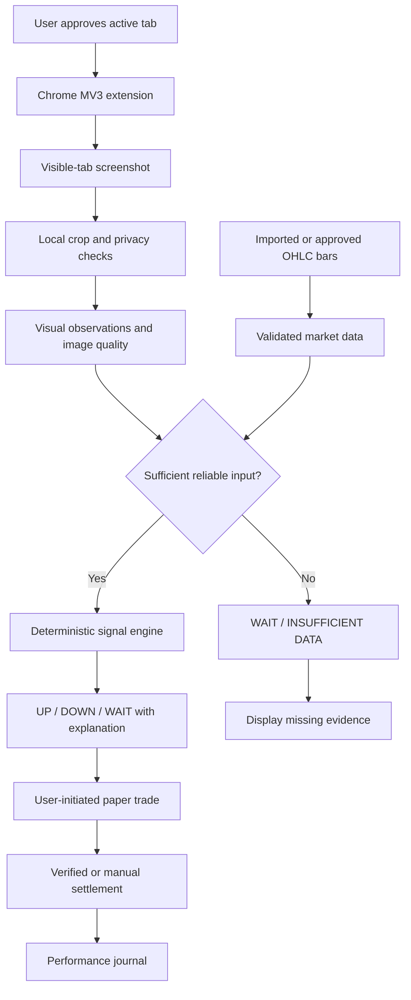

# CHARTSENSE — AI-Assisted Trading Chart Analyzer

> **Primary project context for an AI coding agent.** This document is the single source of truth for the intended software product. Implement it incrementally, keep results truthful, and never treat trading predictions as guaranteed profits.

| Field | Value |
|---|---|
| Working name | ChartSense (renameable) |
| Project type | Local-first Chrome browser extension + optional local analysis service |
| Project owner | Kyle Angelo C. Castro, BSIT 3 student |
| Status | Project specification; not an implemented or validated application |
| Initial target | User-authorized analysis of a visible trading chart, with a Chrome side panel |
| Example platform | ExpertOption, **only to the extent its current terms permit**; do not build special access or execution integrations |
| Primary output | **UP / DOWN / WAIT** for fixed-expiry setups, or **BUY / SELL / WAIT** for appropriate conventional instruments, with an explanation |
| Initial operation | Simulation / paper trading only; no real-money orders |
| Source review date | 2026-11-09 |

## 0. Instructions to any AI developer reading this

1. Read this document, then `AGENTS.md`, `docs/IMPLEMENTATION_ROADMAP.md`, and `docs/SOURCES.md` before proposing or writing code.
2. Build a working product, not mockups disguised as functional features. Mark mocks, demo data, unverified analysis, and future features unmistakably.
3. Start with the smallest vertical slice: a loadable Chrome extension, a real side panel, user-initiated capture, a chart-region selector, and a visible analysis result. Then add rules and a paper-trading journal.
4. **Never automate actual orders, deposit/withdrawal actions, login, clicks on trading buttons, private APIs, network interception, or platform anti-bot evasion.** No credential harvesting, session-cookie extraction, injected scripts into trading site internals, or reverse engineering.
5. No rule, indicator, LLM, or image model guarantees a favorable trade. Prefer **WAIT / INSUFFICIENT DATA** rather than fabricating precision or pressuring trades.
6. Respect platform terms, browser permissions, user privacy, rate limits, and applicable law; where permission/legality is uncertain, stop or use synthetic/demo charts.
7. Before changing technical design, explain any tradeoff and update this document when changing a major decision. Do not silently expand scope.
8. Keep secrets out of extension source, source control, screenshots, console logs, and client bundles.
9. For each milestone: implement, lint/typecheck, test, verify in Chrome manually when possible, record known limitations, and commit a coherent change.
10. If a requirement cannot yet be implemented reliably, build a functioning fallback and describe the limitation instead of pretending the component works.

---

## 1. Vision and problem statement

### User vision

I want to open an online trading website in Chrome and receive **timely, explainable trading setup suggestions derived from the chart that I can already see**. I want the app to recognize what is happening on the screen and explain whether an UP, DOWN, or WAIT setup exists. The system should help me learn disciplined chart analysis, record the quality of its predictions, and test a strategy **without using real money**. The ultimate goal is to evaluate whether a strategy shows any genuine, repeatable predictive value—not to claim that AI can guarantee income.

### Problem

A beginner watching short-term charts may find it difficult to consistently identify trends, support/resistance, breakouts, reversals, noisy conditions, and uncertain screenshots. They may also act on emotional guesses and lack a record of which signals actually worked. An assistant can structure the evaluation, explain the inputs, and measure outcomes; it cannot eliminate market risk.

### Why a browser extension?

The user wants analysis *beside* an existing website rather than a replacement trading platform. Chrome's `sidePanel` API supports a persistent extension interface beside the active tab [S2]. Chrome's `tabs.captureVisibleTab()` can capture the currently visible tab when appropriate permissions are granted; the browser documents a maximum of two such captures per second, so the application should use a significantly slower, configurable rate [S3]. **It captures visible tab content, not a magical hidden market feed.**

### Core product principle

**Human-in-control, analysis-only, uncertainty-aware, local-first, auditable.**

---

## 2. Definitions (important: do not mix these products)

- **Fixed-expiry / binary-style trade:** A direction prediction that is settled at a chosen expiration time. The exact product's contract and payoff terms govern outcomes. Display suggestions as **UP**, **DOWN**, or **WAIT**, not as ownership of an asset. Typical conventional stop-loss logic may not apply.
- **Conventional trade:** Buying or selling an asset or position where entry, stop, and target may be meaningful. Display **BUY**, **SELL**, or **WAIT** only where that terminology fits the instrument.
- **Chart timeframe:** Interval represented by one candle, such as 1m, 5m, or 15m.
- **Prediction / expiry horizon:** The future interval over which an UP/DOWN outcome is evaluated. This is different from the chart timeframe.
- **Screenshot-derived observation:** A visual estimate that may be approximate. Never silently label it as exact exchange or platform quote data.
- **Authoritative OHLCV:** Timestamped open/high/low/close/(volume) values from a suitable *authorized* feed or imported dataset. This is preferable for reliable indicator calculations.
- **Candidate signal:** A rules-based suggestion. It is not an order, a guarantee, or a verified market forecast.
- **Paper trade:** A simulated entry and settlement recorded separately from any real brokerage activity.

**Platform note:** ExpertOption's published terms include restrictions on bots and abusive software interactions [S5]. Its FAQ describes virtual demo funds [S6]. This document does **not** establish that any proposed interaction with a particular site is approved. Confirm current platform rules before testing on a live session; never bypass restrictions. Initial development must use synthetic charts, test images, imported historical bars, or permitted demo usage.

---

## 3. Scope and measurable goals

### MVP must deliver

1. Loadable **Chrome Manifest V3** extension with a clean, dark, responsive **React + TypeScript** side panel.
2. Explicit **Start capture**, **Capture once**, **Pause**, and **Stop** controls.
3. Clear indication of the tab being analyzed and a user-controlled **chart crop selector**. No automatic collection from unrelated tabs.
4. Visible, timestamped preview of the selected region, with image quality warnings.
5. A structured output card: **UP / DOWN / WAIT** (or BUY / SELL / WAIT where appropriate), reason, input evidence, missing data, freshness, and analysis method/version.
6. A deterministic baseline strategy that works on **imported or synthetic timestamped OHLC data**; when real chart bars cannot be recovered confidently from a screenshot, return **WAIT / INSUFFICIENT DATA**, not invented EMA/RSI values.
7. Paper-trading log with simulated stake, advertised payout (if applicable), expiry/horizon, signal, outcome, net P&L, and assumptions. Manual settlement is acceptable in the MVP; no fabricated win rates.
8. Privacy-first defaults: crop before transfer, no automatic cloud image upload, no stored credentials, no permanent raw screenshots unless explicitly enabled.
9. User-visible error states (permission expired, no chart selected, tab switched, screenshot failed, blurry view, insufficient bars, outdated quote, model error).
10. Tests for signal generation, timing, outcome calculation, security boundaries, and browser permission handling.

### Success criteria for an engineering MVP (not profitability claims)

- Extension installs using Chrome's **Load unpacked** workflow and opens its side panel without runtime errors.
- User can capture **only after an explicit user gesture and the necessary permissions**; no hidden surveillance.
- A crop remains aligned after resizing and handles scaling/device pixel ratio.
- A sample chart image displays correctly; unsupported or obscured charts fail safely.
- Importing a valid fixture of timestamped OHLC bars yields a deterministic test result, while invalid or incomplete fixture data yields WAIT.
- Signal timestamps, timeframes, horizons, and data origins are present in every saved record.
- A paper trade can be entered, settled, and reflected in performance statistics with correct arithmetic.
- Every test and any known failure is documented; no demo-only UI is labeled live production analysis.

### Explicitly out of scope

- Real-money trading, automatic order execution, account control, deposits, withdrawals, copy-trading, or trade-button click automation.
- Hidden platform API access, scraping nonpublic endpoints, WebSocket interception, session-token usage, browser exploit techniques, CAPTCHA evasion, or anti-bot workarounds.
- Guaranteed profitability, a claimed calibrated 'AI confidence percentage' without calibration, high-frequency predictions, market manipulation.
- Native mobile apps, a public multi-tenant cloud service, paid subscriptions, complex social features, or an autonomous agent that trades without user approval.
- Predicting a live platform's settlement outcome from an unrelated market data feed without verifying that price/timestamp definitions actually match.

---

## 4. Target user journey

1. The user opens Chrome and loads ChartSense.
2. On onboarding, the extension explains screen sharing, risks, data handling, and no-automatic-trading policy.
3. The user opens a permitted chart/demo and clicks the extension icon, granting a user-initiated `activeTab` access where supported.
4. The side panel opens. The user selects the visible chart area by drawing a rectangle on a **captured preview**, without modifying the site.
5. The user selects instrument type, asset label, chart timeframe, intended prediction horizon, and (if fixed-expiry simulation) illustrative net payout as a fraction of stake. Values not read reliably from the screen must be manually confirmed.
6. The user clicks **Analyze once**. Later, they may enable an explicitly consented periodic scan (e.g., every 5 seconds) with a clear stop button.
7. The app captures the authorized visible tab, crops the specified region, checks resolution/freshness, and extracts **observations**. It uses verified OHLC bars, if available, for numerical indicators.
8. The signal engine evaluates market data and either displays a reasoned candidate or WAIT.
9. If the user wishes, they click **Simulate trade** to start a *paper trade*, never a real order.
10. The app settles the simulation from valid subsequent price data when available, or requires honest manual entry of a verified result. It preserves historical inputs for reproducibility.
11. The journal and analytics display results with sufficient-sample warnings, not sensational claims.

### Required screen states

- **Idle:** 'Select a chart and start capture.'
- **Capturing:** source tab, next scan time, live capture permission status.
- **Analyzing:** progress indicator, snapshot timestamp, no stale signal displayed as current.
- **UP/DOWN candidate:** a concise rationale and observable evidence, horizon and data quality; never trigger action on the trading site.
- **WAIT:** no adequate setup, conflicting evidence, or explicit reason for waiting.
- **INSUFFICIENT DATA:** missing candles, failed OCR, out-of-date image, mismatched feeds or unknown horizon.
- **Paused / error:** actionable recovery information.
- **Paper trade:** simulated stake, expiry, outcome and P&L, clearly marked **SIMULATED**.

---

## 5. Feature requirements

### FR-01: Extension and panel

- Manifest V3; compatible with modern stable Chrome.
- Persistent side panel built with React, TypeScript and Tailwind CSS.
- Toolbar: Start/Stop, Analyze once, Choose chart region, Settings, Journal.
- The panel must **not** click, cover, or alter the broker's controls. Do not inject scripts into the trading site's application internals.
- Permission requests must explain purpose; follow least privilege. Prefer an explicit extension-action user gesture + `activeTab` over broad `all_urls` permissions.

### FR-02: Capture and cropping

- Implement capture in a Chrome extension context that is permitted to call the API; side panel/service worker message architecture is acceptable.
- Capture only the current **user-approved visible tab**, not arbitrary background tabs.
- In the MVP, capture-on-demand is mandatory; periodic scanning is optional after the core works.
- Default interval suggestion: **5 seconds**, configurable. Respect browser capture limits, API/model costs, and platform permissions. Chrome documents a maximum of **2 calls/second**, not a recommended frequency [S3].
- Abort scans on tab navigation, source changes, lost access, or Stop. A tab change should not silently transfer capture permissions to a new site.
- The chart selection rectangle is stored relative to preview dimensions and translated to original screenshot pixels correctly; validate and clamp bounds.
- Detect changes in page zoom, resolution, chart location, or browser window size and require user re-selection when necessary.
- Crop, downscale, and redact unrelated information locally before optional model analysis.
- Save cropped images only with clear user opt-in; default to transient in-memory processing.

### FR-03: Image analysis and data quality

- Separate **recognition of what the chart shows** from **generation of a trading signal**.
- Visual recognition can detect apparent candle direction, broad trend, approximate horizontal levels, visible labels, and whether indicators appear on screen.
- OCR and vision models can misread candles, decimal points, axes, colors, time, and symbol labels. Return a structured uncertainty/missing-fields result.
- Do **not** compute precise EMA20/EMA50, RSI14 or MACD from a lone screenshot unless a validated timestamped candle series has been reconstructed with measurable accuracy; imported/authorized OHLC bars are the preferred inputs.
- If the chart lacks enough bars, time labels, identifiable quote scale or a reliable horizon, return insufficient-data state.
- Distinguish actual observations from inferred or assumed values and display source type.
- Never pass screenshots containing usernames, balances, messages, account IDs, or credentials to a third-party AI service without informed opt-in and safe redaction.

### FR-04: Signal engine

The output is one of `UP`, `DOWN`, `WAIT`, `INSUFFICIENT_DATA`, `ERROR`. In conventional asset mode the UI may map suitable directional conditions to `BUY`/`SELL`; do not equate these with ownership or a live order for fixed-expiry contracts.

**Evidence categories:**

- Trend direction and slope (e.g., EMA20/EMA50 where computed from valid OHLC history)
- Support/resistance and prior highs/lows with a tested, explicit look-back
- Breakout/retest confirmation; avoid a single ambiguous pixel/candle
- Optional momentum: RSI14 and MACD only on accurate, timestamped OHLC bars
- Candle quality/volatility, sideways movement, gaps, or unusually unstable conditions
- Signal freshness and target horizon
- Whether the available data actually comes from the same market/instrument as the visible platform

**Initial illustrative baseline (to be verified, not a promised winning strategy):**

1. Require validated asset, timeframe, horizon, and sufficiently complete, timestamped OHLC bars. The bar count must support the longest lookback and indicator warmup; do not assume 20 or 50 candles are enough for stable values.
2. Mark trend UP when EMA20 > EMA50 **and** recent structure is consistent with higher highs/higher lows; trend DOWN for the opposite. If conflicting, WAIT.
3. Consider an UP candidate only with a trend-aligned, *confirmed* resistance breakout or support pullback/retest. For DOWN, require the symmetrical conditions.
4. Use optional RSI/MACD as filters, not automatic proof. Sideways conditions, incomplete candles, stale data, obvious feed mismatch, or conflicting conditions → WAIT.
5. Do not score candidates with made-up accuracy percentages. If displaying a 'setup quality' label, use an explicit rubric (`poor`, `mixed`, `clear`) and label it as **rule-based, uncalibrated**.
6. Version every strategy and parameter set. Make thresholds configurable through settings with sensible defaults and test fixtures.

**Why these ideas?** The attached trading guide covers trend confirmation, resistance breakouts, support pullbacks, pre-defined entries, exits and risk discipline [S1, pp. 1–3]. EMA20/EMA50, RSI14, MACD, and this exact decision logic are **proposed engineering hypotheses**, not claims made by the guide or validated profitable settings.

### FR-05: Explainability

For each result, show:

- result and analysis timestamp
- source type: `visual_only`, `imported_ohlc`, `authorized_feed`, or `demo_fixture`
- asset and contract type, confirmed or explicitly user-entered
- chart timeframe and intended prediction horizon
- detected evidence (human-readable)
- missing inputs / assumptions / reasons to WAIT
- raw indicator values only when derived from validated data
- strategy name, version, and parameter snapshot
- stale or low-quality flags

Example UI (invented scenario, **not live advice**):

```text
ChartSense • SIMULATION
Instrument: EUR/USD | Timeframe: 5m | Prediction horizon: 10m
Result: WAIT
Trend: mixed | Pattern: no confirmed breakout
Data source: demo OHLC fixture | Updated: 14:35:00
Reason: Trend and momentum filters disagree.
Missing: none | Strategy: baseline-v0.1
Actions: [Analyze again] [View evidence] [Record in journal]
```

### FR-06: Paper-trading journal

- Explicit simulation mode badge **SIMULATED / NO REAL ORDERS**.
- Manual simulate button, amount, payout fraction (if relevant), horizon, snapshot of signal/rule version, and known market time.
- Store `source_type`, `entry_time`, `entry_price` (if verified), `expiry_time`, `expiry_price`, `result`, `settlement_method`, and `assumptions`.
- If price settlement is unverifiable, mark paper trade `UNVERIFIED` rather than automatically count a win.
- Report trade count, wins, losses, ties/refunds separately, hit rate, net P&L, average payout, maximum drawdown, breakdown by strategy/timeframe, and sample size warning.
- Default bankroll is simulated. Add an optional simulated daily-loss limit and no-overtrading reminder.
- Export/import CSV or JSON for testing; never store site usernames/passwords or real broker account data.

### FR-07: Privacy, safety, and observability

- Explicit consent each capture session, easily accessible Stop, no silent startup scan.
- Local-first history, e.g. IndexedDB for journal and browser storage for nonsecret preferences.
- Cloud AI disabled by default; user must knowingly enable cropped upload with a preview.
- Strict API-input validation, least privilege, rate limiting, resource caps and data retention policy.
- Log sanitized events, not raw browser images or secrets; expose capture and interpretation errors in UI.
- Clearly label any illustrative chart, screenshot, hypothetical indicator value, and paper result.

---

## 6. Suggested UI and UX specification

### Visual direction

- Professional dark trading terminal aesthetic with high readability; not flashy gambling-style persuasion.
- Colors: neutral/dark surfaces, restrained green UP, restrained red DOWN, slate/amber WAIT and warnings. Use color **plus** icon/label for accessibility.
- Dense but legible information, good contrast, keyboard navigation, reduced-motion support, and responsive layout as panel width changes.
- Do not market '100% accuracy', 'guaranteed returns', or fake countdown urgency.

### Side panel information hierarchy

```text
+---------------------------------------------------+
| ChartSense              [SIMULATION]    Settings   |
| Source: [Current tab]    [Select chart region]     |
| [Capture once]  [Start monitoring]  [Stop]          |
|                                                    |
| Asset: EUR/USD      Mode: Fixed-expiry (demo)       |
| Chart timeframe: 5m   Horizon: 10m                 |
|                                                    |
| +-----------------------------------------------+ |
| |             Cropped chart preview             | |
| +-----------------------------------------------+ |
| Screenshot: 14:35:04   Source: visual only          |
|                                                    |
| Result: WAIT / INSUFFICIENT DATA                   |
| Trend: mixed   Quality: incomplete                 |
| Why: not enough reliable candle data              |
| What is missing: verified OHLC bars                |
|                                                    |
| [Show reasoning inputs] [Simulate paper trade]     |
|                                                    |
| Journal | 0 verified results | No accuracy claim   |
+---------------------------------------------------+
```

**Pages/tabs:** Assistant, Capture setup, Paper journal, Performance, Settings, About/Risk notice.

**Critical UX behavior:** A visually attractive green/red recommendation must never be the only information. It must always include evidence, freshness, limitations, and a visible option to do nothing.

---

## 7. Architecture and data flow

### Recommended architecture

- **Extension UI:** React + TypeScript + Tailwind + Vite.
- **Extension background/service worker:** capture orchestration and permission-aware messaging; no autonomous trading.
- **Local browser modules:** crop/resize, metadata extraction, state machine, persistence adapter.
- **Strategy engine:** deterministic, pure TypeScript implementation for OHLC-driven indicators is preferred for a low-complexity MVP; test against reference fixtures.
- **Optional Python analysis service (Phase 3+):** FastAPI + OpenCV + NumPy/pandas for more demanding vision experiments. Use a local server and explicit localhost connection; do not make it a prerequisite for the first screenshot feature.
- **Optional AI vision adapter (later):** model analyzes a sanitized crop and returns constrained JSON observations, not orders or definitive forecasts. Do not store API credentials in the extension. Use a local model or server-side proxy only with user opt-in.
- **Persistence:** IndexedDB for journal and captured metadata; browser storage for settings; PostgreSQL/Supabase only if future sync has a clear need.

### Data flow



### Architecture rules

- Keep **tab capture**, **image analysis**, **market data validation**, **signal engine**, and **simulation settlement** as separate modules with typed interfaces.
- Extension UI must function even if optional local Python service or cloud inference is unavailable.
- Service-worker lifetime may be interrupted; persist necessary configuration and recover without accidentally restarting capture.
- Prevent concurrent scans, overlapping requests, race conditions and stale results (use request IDs, abort/cancel when possible, and source-tab checks).
- Never infer an exact price from a screenshot if scale/OCR precision is unknown. Never silently substitute another feed for a broker's actual payout/quote.
- Build an adapter architecture for modes, **not invasive per-site integrations**.

### Proposed repository layout

```text
chartsense/
├── PROJECT_CONTEXT.md             # Canonical product/architecture document
├── AGENTS.md                      # AI coding agent rules
├── README.md                      # Setup, commands, limitations
├── docs/
│   ├── IMPLEMENTATION_ROADMAP.md
│   ├── SOURCES.md
│   └── DECISIONS.md               # Architecture decisions as implemented
├── reference/
│   └── trading_buy_sell_guide.pdf # Original user-supplied reference
├── apps/
│   └── extension/
│       ├── manifest.json
│       ├── src/
│       │   ├── background/
│       │   ├── sidepanel/
│       │   ├── capture/
│       │   ├── analysis/
│       │   ├── signals/
│       │   ├── journal/
│       │   ├── storage/
│       │   ├── components/
│       │   └── types/
│       └── tests/
├── services/
│   └── vision-api/                # Optional, later phase only
├── packages/
│   └── strategy-core/             # Add if truly useful; don't overengineer
└── fixtures/
    ├── charts/
    └── ohlc/
```

**Important:** This is a *target structure*, not an assertion that files already exist. Generate only what the current phase needs. It is acceptable to start with a single `apps/extension` package and split later.

---

## 8. Interfaces and contracts

### Example structured analysis result (illustrative contract)

```json
{
  "id": "analysis-demo-001",
  "status": "WAIT",
  "instrumentType": "fixed_expiry_demo",
  "assetLabel": "EUR/USD",
  "chartTimeframeSec": 300,
  "predictionHorizonSec": 600,
  "capturedAt": "2026-11-09T06:35:00Z",
  "dataSource": "demo_fixture",
  "imageQuality": "readable",
  "barDataVerified": true,
  "strategyId": "baseline-v0.1",
  "reasonCodes": ["TREND_CONFLICT", "NO_CONFIRMED_BREAKOUT"],
  "explanation": "No reliable trend-aligned breakout was confirmed.",
  "observations": ["mixed_trend", "range_bound"],
  "missingFields": [],
  "assumptions": ["All market data in this example is synthetic."],
  "actionableAsOrder": false
}
```

- Use schema validators (e.g., Zod) and strict TypeScript.
- `capturedAt` and all settlement times use ISO 8601 UTC internally; display local time with timezone labels.
- Candidate results must include **expiry/horizon and freshness**; if unavailable, do not emit an actionable direction.
- Never save or return an invented `confidence: 0.95`. If calibrated probabilities are later added, document methodology and reliability testing.
- Never treat the sample above as current prices, live market observations, or actual analysis output.

### Core data types (suggested)

```typescript
type Direction = 'UP' | 'DOWN' | 'WAIT' | 'INSUFFICIENT_DATA' | 'ERROR';
type DataSource = 'visual_only' | 'imported_ohlc' | 'authorized_feed' | 'demo_fixture';
type InstrumentType = 'fixed_expiry_demo' | 'conventional_demo';

type Candle = {
  time: string; // UTC close/open timestamp, interpretation documented
  open: number;
  high: number;
  low: number;
  close: number;
  volume?: number;
};

type AnalysisResult = {
  id: string;
  status: Direction;
  source: DataSource;
  instrumentType: InstrumentType;
  assetLabel: string;
  chartTimeframeSec: number;
  predictionHorizonSec: number;
  capturedAt: string;
  strategyVersion: string;
  barDataVerified: boolean;
  evidence: string[];
  missingFields: string[];
  explanation: string;
  isSimulation: true;
};
```

### Suggested browser storage (MVP)

- `settings`: scan interval, privacy opt-in, asset/horizon preferences, theme and risk preferences.
- `capture_sessions`: source tab ID, start/stop times, chart crop, current permission status; avoid storing unnecessary URLs.
- `analysis_records`: timestamp, source, strategy version, evidence, decision, missing fields, input data checksum/reference.
- `paper_trades`: signal ID, simulated stake, payout fraction, entry/expiry times, verified/unverified prices and outcome.
- `strategy_versions`: settings and indicator lookbacks used for each saved run.

Retain user-generated results without requiring raw screenshot retention. Support clear/export/delete actions.

### Optional local API, only if needed

```text
GET  /health
POST /analyze-cropped-chart  -> image quality + structured visual observations
POST /evaluate-ohlc         -> validated strategy result
```

No `/buy`, `/sell`, `/place-order`, `/click`, `/login`, or `/withdraw` endpoint. API may be omitted entirely from MVP. If introduced, bind to loopback, validate requests and origin, use request size limits and a local auth token, and never expose it publicly by default.

---

## 9. Paper-trade math and evidence standards

For a fixed-expiry simulation that loses the full stake on a loss and pays **net profit** equal to payout fraction `r` times stake on a win, ignoring fees/ties:

- `profit_win = stake * r`
- `profit_loss = -stake`
- `net_pnl = sum(profit_win or profit_loss for verified trades)`
- `breakeven_win_rate = 1 / (1 + r)`

**Illustrative math only** (not a current ExpertOption quote):

| Net payout on win | Required win rate to break even (no fees, no ties) |
|---|---|
| 70% | 58.82% |
| 80% | 55.56% |
| 90% | 52.63% |

If the real product includes fees, partial refunds, different settlement rules or payout variability, modify the model; do not imply the simplified calculation is universally correct. The CFTC/SEC describes the all-or-nothing character and risks of binary options [S7].

### Evaluation discipline

1. Record signals **before** the outcome is known; avoid look-ahead and chart repainting bias.
2. Use timestamped bars and align entry and expiry carefully; don't silently assume screenshot capture time equals tradable entry price.
3. Distinguish a **signal test** from a **tradable strategy**; broker prices, delays, spread, and payouts may make a visual pattern nonprofitable.
4. Split historical data into train/development, validation, and untouched test periods in chronological order. Use walk-forward analysis where practical.
5. Report the full confusion matrix or UP/DOWN/WAIT counts, sample size, hit rate, P&L and drawdown; report skipped signals as well.
6. Never advertise a '90% success rate' from cherry-picked screenshots or only a handful of observations.
7. Avoid optimizing the strategy on the evaluation period. Maintain versioned parameter sets and repeatable fixture tests.
8. Use paper trading for a substantial period before drawing conclusions; this specification sets **no promise of profit** even if tests appear favorable.

---

## 10. Privacy, security, platform restrictions

### Mandatory safety rules

- Respect any platform restrictions. ExpertOption's official published terms prohibit automated players/bots in the context of abusive use [S5]; do not build broker automation or evasion. Independent screenshot analysis on a trading website is **not automatically approved**—read current terms and obtain authorization if needed. Use test fixtures if uncertain.
- `activeTab` is temporary and depends on user invocation [S3]. **Do not** assume clicking an internal side-panel button grants the same access; handle reauthorization appropriately.
- Ask for only needed extension permissions (`sidePanel`, `activeTab`, `storage`, and other permissions only if concretely justified). Never request blanket site access merely for convenience.
- On Stop or navigation, shut down capture timers, discard pending frames, and prevent old results from being shown as fresh.
- No credential forms that impersonate the broker; no handling site session cookies, account balances, login tokens, or payment details.
- Do not inject scripts to execute trading actions or inspect hidden client-server communications.
- Manifest V3 code must be packaged with the extension; follow Chrome Web Store rules about remote code [S8].
- Clear privacy description and user consent before optional cloud vision uploads, especially if the crop could include financial or personal information.
- Include a plain-language risk warning: trading and fixed-expiry products can lead to full stake loss; signals are informational, not financial guarantees [S7].

### Security checklist

- [ ] No `.env` or private keys committed to source control.
- [ ] Extension CSP reviewed; no remote executable scripts or unsafe inline execution patterns.
- [ ] Message payloads and URLs validated; untrusted web content cannot issue privileged extension actions.
- [ ] Cross-origin requests restricted; no wildcard CORS in production/local API.
- [ ] Capture data stored only when explicitly configured.
- [ ] Export/delete personal journal data works.
- [ ] Rate limiting and cancellation work.
- [ ] No executable trading automation exists.

---

## 11. Testing and quality gates

### Unit tests

- Strategy fixture: clear mock uptrend + confirmed pattern returns a candidate, as expected from versioned rules.
- Strategy fixture: contradictory trend signals returns WAIT.
- Missing/unsorted/duplicate/invalid OHLC timestamps or insufficient lookback returns INSUFFICIENT_DATA.
- `high >= max(open,close)`, `low <= min(open,close)`, finite prices, monotonic timestamps, and timeframe checks enforced.
- If a bar is still forming, it is either excluded or explicitly marked incomplete; strategy cannot silently look ahead.
- Timeframe and horizon stay separate; 1-minute candle != 1-minute expiry.
- Crop boundary transforms correct on zoom and high DPI; empty/out-of-bounds crop rejected.
- Capture permission denial, tab switching, navigation, and service worker recovery do not leak images or continue processing.
- Fixed-expiry `net_pnl` and break-even calculations correct; unverified results excluded from verified-win metrics.
- Strategy output always includes source type, timestamp, reason, version and missing-data list.

### Integration tests

- Extension build installs as unpacked without warnings about missing files.
- Action icon opens side panel; capture-on-click works for a permitted test page.
- Analyze once yields a result only after actual processing, never a hardcoded fake recommendation.
- Start → visible monitoring → Stop stops scanning and the UI visibly reflects state.
- Crop survives panel resizing but asks for reselection when source layout changes.
- A fresh test screenshot has provenance; stale queued analysis does not overwrite newer results.
- Journal exports and imports meaningful records.

### Manual acceptance demonstration

1. Install extension on desktop Chrome.
2. Open a local synthetic candlestick test page (not necessarily a real broker).
3. Select chart region and capture once.
4. Verify actual crop and screenshot timestamp.
5. Feed known timestamped fixture bars into strategy; see deterministic signal with evidence.
6. Replace fixture with insufficient data; see WAIT/INSUFFICIENT DATA, not hallucinated confidence.
7. Create, settle and export a paper trade; verify P&L arithmetic.
8. Press Stop, change tabs, deny permission; confirm no further capture and clear errors.

---

## 12. Implementation plan and priorities

**Follow `docs/IMPLEMENTATION_ROADMAP.md` for detailed tasks and completion criteria.** Keep phases sequential; make each phase independently demonstrable.

| Phase | Deliverable | Required milestone |
|---|---|---|
| 0: Foundation | Vite + React + TypeScript MV3 extension, lint/tests, side panel | Installable and functional shell |
| 1: Capture | Permission-aware user-initiated screenshot, crop tool, source checks, error UI | Real pixels captured and cropped |
| 2: Deterministic analysis | Import OHLC fixture, calculate tested indicators, generate structured candidate/WAIT | Verified rule engine, not screenshot guessing |
| 3: Screen interpretation | Basic chart quality/label recognition, structured observation, data confidence gate | Accurate separation of visual observations from OHLC |
| 4: Journal | Paper orders, settlement, P&L, export, strategy versions | Reproducible simulated performance |
| 5: Opt-in monitoring | Slow periodic user-authorized capture, notification throttles, stale-data protections | Visible, stoppable monitoring |
| 6: Optional advanced service | Local OpenCV/FastAPI or opt-in vision model, improved visual recognition | Only if validated improvement merits complexity |

**Do not begin Phase 6 or add Supabase/authentication until earlier phases work.**

### Nice-to-have after validation

- User import of licensed/authorized historical CSV bars.
- Annotation of screenshot crop with recognized visual support/resistance regions (as estimates, not exact prices).
- Read-only strategy comparison and backtest dashboard.
- A replay mode for pre-recorded charts, with no use of future bars during prediction.
- A calibration report for any forecast probabilities, if later trained with enough honest data.
- Optional safe notifications (signal changed, feed stale, capture paused), never 'must trade now' prompts.

---

## 13. Key open decisions — do not guess silently

These choices can be set as safe defaults during implementation and later changed in Settings:

1. **Brand name:** ChartSense (working title).
2. **Initial instrument:** synthetic/demo fixed-expiry mode; support conventional demo via adapter later.
3. **UI:** dark, information-dense but clear, Chrome desktop side panel.
4. **Data:** start with imported/test OHLC for numerical analysis and screenshot crop for visual observations.
5. **Capture:** user gesture mandatory; first implement on-demand, then opt-in 5-second interval.
6. **AI:** optional. No dependency on paid model API for the working MVP.
7. **Persistence:** local-first IndexedDB; Supabase optional, not required for MVP.
8. **Prediction horizon:** explicitly user selected; never guessed from chart timeframe.
9. **Trading site compatibility:** first prove on local chart test page; platform-specific use requires separate policy review and must not enable order execution.
10. **Accuracy target:** no predetermined profitability or precision target. Evaluate accuracy transparently with out-of-sample evidence and measure trading payoffs separately.

---

### Decision updates (2026-11-10, owner request; see docs/DECISIONS.md D-020 to D-022)

- **Live website analysis is now the primary input.** ChartSense captures the authorized tab at a user-chosen interval while monitoring is on, and analyzes the cropped chart with a **local** vision model (Ollama, `qwen3-vl:4b`; free, no cloud, loopback only).
- **Screenshot-based UP / DOWN is allowed** through the deterministic `visual-v0.1` rule over constrained visual observations, with two-snapshot confirmation. It still never derives prices, EMA, RSI or MACD from pixels, never shows a confidence number, and returns WAIT / INSUFFICIENT DATA when the chart, model or context is inadequate. This supersedes the earlier FR-03/FR-04 limit that screenshots alone could only yield WAIT.
- **OHLC file import** remains, as a developer/testing tool, not part of monitoring.
- **Model training track** (D-029): `training/` holds the dataset, evaluation and backtest tooling. Training data comes only from synthetic charts or explicit, privacy-reviewed exports the user saves; the model only describes charts, the rule engine decides signals. No fine-tuned model is used until it beats the baseline on real held-out data. Real crops can get model **drafts** (D-031), but only labels a person approved are used or exported.
- **`visual-v0.2`** (D-026) applies the setups of the second user guide, `reference/stock_trends_buy_sell_guide.pdf` [S9]: pullbacks, range breakouts, completed continuation and reversal patterns. A pattern counts only after it completes. **`visual-v0.3`** (D-028) adds the falling wedge and the close-not-wick rule from `reference/best_chart_patterns_trading_guide.pdf` [S10].

## 14. Recommended first prompt to a coding AI

> Read `PROJECT_CONTEXT.md`, `AGENTS.md`, `docs/IMPLEMENTATION_ROADMAP.md`, and `docs/SOURCES.md`. Treat them as the requirements. First summarize the MVP architecture and create a short ordered implementation checklist. Then **implement Phase 0 and Phase 1 only**: a working Chrome MV3 extension with React/TypeScript/Tailwind, dark side panel, user-authorized visible-tab capture, screenshot preview, crop selection, Start/Stop state handling, helpful errors, and a local mock chart test page. Do not invent profitable signals, and do not implement any broker integration or trade execution. Include `README.md` with exact tested setup/run/build/load-unpacked instructions, lint/types/tests, and record any browser permission limitation. Do not claim success without actual code and verification. Once Phase 1 is complete, report files changed, commands run, test outcomes and the next step.

See also the more detailed ready-to-paste prompt at `docs/AI_BUILD_PROMPT.md`.

---

## 15. Sources, provenance and assumptions

Read `docs/SOURCES.md` for details and full URLs. These are **sources**, not evidence that this specific application has been tested.

- **[S1] User-provided PDF**, `reference/trading_buy_sell_guide.pdf`, *Trading: When to Buy or Sell*, pages 1–3. Rules about trends, breakout/pullback, predefined entry/exit, profit/stop logic, speculative risk and journal. Important: the guide is oriented partly toward conventional trading and does not provide a validated ExpertOption strategy or screenshot extraction algorithm.
- **[S2] Chrome Developers, Side Panel API:** https://developer.chrome.com/docs/extensions/reference/api/sidePanel
- **[S3] Chrome Developers, Tabs API (`captureVisibleTab`, `activeTab` and capture limit):** https://developer.chrome.com/docs/extensions/reference/api/tabs
- **[S4] Chrome Developers, Screen capture:** https://developer.chrome.com/docs/extensions/how-to/web-platform/screen-capture
- **[S5] ExpertOption, Terms & Conditions (section 6.2 among others):** https://en.expertoption.com/company/policy/terms/
- **[S6] ExpertOption, FAQ (demo funds):** https://en.expertoption.com/trade/faq/
- **[S7] U.S. CFTC/SEC, *Investor Alert: Binary Options and Fraud*:** https://www.cftc.gov/LearnAndProtect/AdvisoriesAndArticles/fraudadv_binaryoptions.html
- **[S8] Chromium, Extensions Security FAQ (MV3 and remote code):** https://chromium.googlesource.com/chromium/src/+/main/extensions/docs/security_faq.md

**Explicit provenance note:** React/Tailwind/Vite, TypeScript modules, 5-second capture default, EMA20/EMA50, RSI14/MACD, strategy rules, UX layout, schemas, architecture, phase plan, and evaluation design are **proposed design decisions**, not statements taken from the user's PDF or established winning strategies. Verify library versions and API details at implementation time. Market/platform claims change; recheck current terms before external deployment.

**Final product constraint:** This is an educational decision-support and paper-trading application. It is **not** a trading-profit generator, and it must never claim otherwise.
